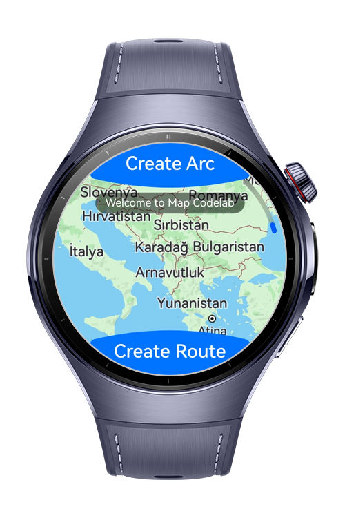
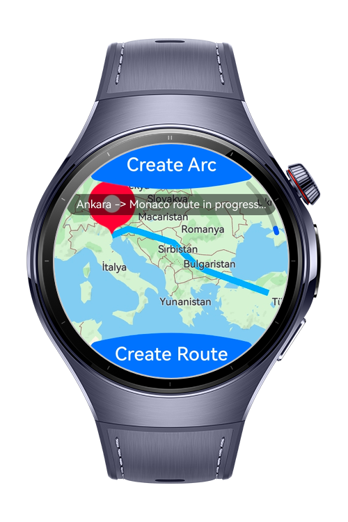
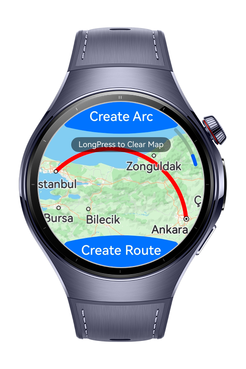
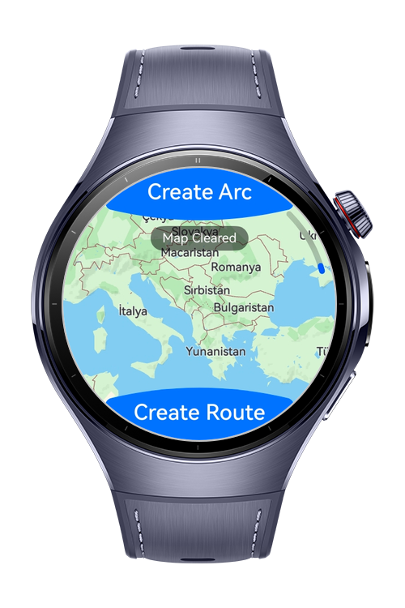

> **Note:** To access all shared projects, get information about environment setup, and view other guides, please visit [Explore-In-HMOS-Wearable Index](https://github.com/Explore-In-HMOS-Wearable/hmos-index).

# How to Build Advanced Map Overlays

The project is an interactive map overlay application built with Huawei Map Kit. It demonstrates advanced map visualization features including custom arc drawing between locations, animated route tracing across multiple cities, dynamic marker updates, camera movement handling, and user interaction events. The application provides real-time feedback during map operations and supports clearing map elements through long press interactions.

# Preview
<div>
  
  
  
  
</div>

# Use Cases
- Interactive map rendering using Huawei Map Kit MapComponent
- Drawing custom arcs between two locations
- Animated route visualization using Trace Overlay
- Multi-city route animation with dynamic marker updates
- Camera movement tracking with map event listeners
- Real-time map interaction feedback through click and camera events
- Marker visibility changes during route animation
- Clearing all map overlays with long press interaction

# Tech Stack
**Languages**: ArkTS  
**Libraries/Kits**:
- @kit.MapKit - MapComponent, TraceOverlay, MapArc, MapEventManager, LatLngBoundsUtils, MapCommon
- @kit.BasicServicesKit
- @kit.ArkUI

# Directory Structure

```
entry/src/main/
└───main
    │   module.json5
    ├───ets
    │   └───model
    │           TracePoint.ets
    │   ├───pages
    │   │       Index.ets // All logic
    │   │
    │
    └───resources
        └───base
            └───profile
                    main_pages.json
```

# Constraints and Restrictions
## Supported Devices
- Watch 5
- Ultimate 2

# LICENSE
**How to Build Advanced Map Overlays** is distributed under the terms of the **MIT License**.
See the [LICENSE](/LICENSE) for more information.